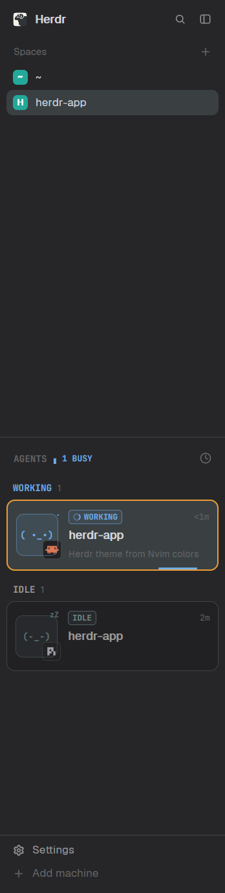

# herdr-jackc0re

A [Herdr](https://herdr.dev) layout: a warm charcoal and amber theme ported from my
jackc0re Neovim/Zed colorscheme, plus an agents sidebar where every agent is a
little ASCII critter that reacts to its status.

| Status | Critter |
|---|---|
| working | `(•_• )` glancing around, bobbing, with a scanner sweeping the card |
| needs you | `(°o°)!` shaking, red border pulsing |
| done | `\(^o^)/` cheering with confetti |
| idle | `(-_-) zZ` dozing |

Plus, adapted from ozcberkay's [Herdr Çoban](https://github.com/ozcberkay/herdr-coban)
and restyled for jackc0re: **THIS PC** vitals (Windows port) and **CLAUDE**
5-hour/weekly limits with a pace mark in the sidebar, and per-tab **Notes** and a
live **Claude Code** session card in the right panel.



## Install

Copy the contents of [`jackc0re/`](jackc0re) into your Herdr home
(`~/.config/herdr-app`), leaving out `RECIPE.md` and `preview.png`:

```
layouts/jackc0re.json
mods/critters/
mods/jackc0re-tabs/
mods/machine-vitals/
mods/claude-status/
mods/tab-notes/
mods/jackc0re-spaces/
mods/wsl/
themes/jackc0re.json
```

For the CLAUDE panels, point Claude Code's status line at the wrapper in
`~/.claude/settings.json` (keep your own status line command, if you have one,
as a single-quoted last argument):

```json
"statusLine": { "type": "command",
  "command": "sh ~/.config/herdr-app/mods/claude-status/statusline.sh --hide-in-herdr" }
```

Heads-up: `machine-vitals` runs PowerShell (Windows only), `claude-status` and
`tab-notes` keep files under `~/.config/herdr-app/`.

Then switch to it:

```sh
for m in critters jackc0re-tabs machine-vitals claude-status tab-notes; do
  herdr-app check ~/.config/herdr-app/mods/$m
done
herdr-app do layout.switch --name jackc0re
```

`ctrl-shift-l` cycles back to your other layouts. Or ask the agent in your Herdr
window to "add herdr.dev/layouts/jackc0re/jackc0re".

To tweak the critters, edit the `CRITTER` table at the top of
`mods/critters/main.js`. Herdr hot-reloads it.

See [`jackc0re/RECIPE.md`](jackc0re/RECIPE.md) for the full brief.

## WSL (NixOS) as a Herdr machine

Optional: spaces, agents and git run natively in a WSL distro (from
[emoss08/herdr-wsl](https://github.com/emoss08/herdr-wsl), MIT, adapted).
`mods/wsl` adds a sidebar row (connection, keepalive, `+` for a WSL space) and
`mods/jackc0re-spaces` (Herdr's 0.1.16 `spaces` + herdr-wsl's two changes) sends
the Spaces `+` to WSL while it is connected. Set `mods/wsl/config.json` to your
machine and distro.

NixOS side (`jackc0re/wsl/`): import `herdr-wsl.nix` (loopback-only sshd on
2222, key-only, linger) and put your own public key in it. Windows side:
`ssh-keygen -t ed25519 -N "" -f ~/.ssh/herdr_wsl_ed25519`, a `Host wsl` entry
(127.0.0.1, port 2222, user, that key), then `hc machine add wsl --install`.
For the CLAUDE panels from Claude Code in WSL, use `herdr-statusline.sh` as its
`statusLine` (it tags terminals `wsl-<id>` and writes to the Windows Herdr home).

## Credits

THIS PC, CLAUDE, Notes and the Claude Code card are adapted from
[ozcberkay/herdr-coban](https://github.com/ozcberkay/herdr-coban) (Apache-2.0,
see `jackc0re/mods/LICENSE-herdr-coban`). The WSL row is from
[emoss08/herdr-wsl](https://github.com/emoss08/herdr-wsl) (MIT, `mods/wsl/LICENSE-herdr-wsl`).
