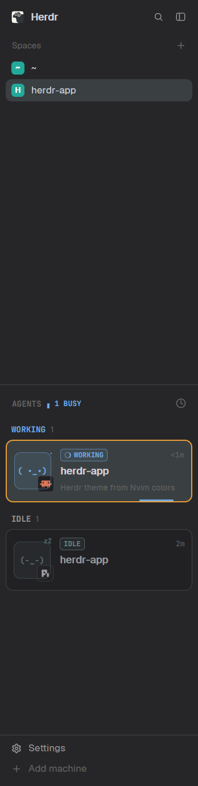

# jackc0re

Herdr's default window in a warm dark charcoal theme with amber accents, ported
from the jackc0re Neovim/Zed colorscheme. The agents list on the left is a stack of
cards, each with a small ASCII critter whose face and motion follow the agent's
status: it glances around while working, shakes when it needs you, cheers when
it's done and snoozes when idle.

The sidebar also opens with this PC's vitals and your Claude subscription limits,
and the right panel has per-tab Notes plus a live Claude Code session card
(adapted for Windows and the jackc0re look from ozcberkay's
[Herdr Çoban](https://github.com/ozcberkay/herdr-coban)).

## What you see

- **Whole window:** the shipped `main` layout plus Çoban's extra blocks. A
  268px sidebar on the left: brand bar (46px), **THIS PC** (100px), **CLAUDE**
  (80px), Spaces and Agents (one weight each), footer (69px). On the right: the
  tab bar (42px) with **Files**, **Changes** and **Notes** buttons, panes as
  cards, the side panel (368px, 280–900) and the status bar (28px).
- **Section labels:** THIS PC, CLAUDE, NOTES and CLAUDE CODE use the same 11px
  bold uppercase JetBrains Mono, `dim`, as the AGENTS header. Row labels (CPU,
  MEM, DISK, 5H, 7D) are 10px bold mono, values 10.5px mono.
- **THIS PC:** a CPU sparkline (24 samples, 2 minutes), a memory bar, the system
  drive's bar with free GB, and a battery line when the PC has one. Bars fill
  `accent`, turning `ansi3` at 85% and `ansi1` at 95% (disk: 90%). Memory turns
  yellow at 80% and red at 92% of RAM or commit.
- **CLAUDE:** a 5H and a 7D bar with a 2px `foreground` mark for how much of
  the window has passed, the used percentage and the time to the reset. Yellow
  at 70% used or a pace of 85%, red at 90% used or a pace of 100%.
- **Side panel:** a stack of Files, Changes and Notes (7 weights) over the
  CLAUDE CODE card (3 weights, min 300px): model and effort chips, context bar,
  cost/time/lines tiles, prompt cache, status-line badges.
- **Theme `jackc0re`:** terminal background `#212124`, terminal text `#B8B8B8`,
  cursor `#cd974b`. Sidebars and bars (`chrome`/`surface`) are `#262629`, popups
  `#2A2A2E`, behind the cards (`canvas`) `#1c1c1f`. Hover and selected are
  `#3a4042`, borders `#454343`. UI text is `#D3D3DB`, muted `#999999`, dim
  `#666666`. The accent is amber `#EA9D34` with `#212124` text on it. Status
  colors: working `#71ade7`, blocked `#e25d56`, done `#73ca50`, idle `#708b8d`.
  The ANSI colors are, in order: `#000000 #e25d56 #73ca50 #e9bf57 #4a88e4
  #915caf #23acdd #cecece`, then bright `#777777 #f36868 #88db3f #f0bf7a
  #6f8fdb #e987e9 #4ac9e2 #ffffff`.
- **Agents header:** `AGENTS` in 11px bold JetBrains Mono, dim. While any agent
  works, it is followed by a quadrant spinner (`▖ ▘ ▝ ▗`, 160ms) and `N BUSY` in
  the working color; otherwise by `all chill` in dim. The sort button stays on
  the right.
- **Group headers:** uppercase JetBrains Mono, bold, in the status color in
  priority view (`WORKING`, `NEEDS YOU`, ...) or muted in grouped view, where a
  1px border-colored line runs to the right.
- **Agent cards:** rounded 10, padding about 10px, background `background`
  (`selected` when focused), 1px `border`. A focused card has a 1.5px `accent`
  border; done has a green border at 56% alpha; working a blue one at 31%.
  - Left: a 50×50 tile, rounded 9, filled with the status color at 11% alpha
    and bordered with it at 44%. It shows the critter face in bold JetBrains
    Mono (11px, 10px for done) in the status color. A twinkle sits above its
    top-right corner, and the agent's program icon sits in a small framed chip
    on its bottom-right corner.
  - Right: a badge row (an uppercase status word in a mono pill: status-color
    border and 9% fill, 9.5px bold; then how long the agent has been in this
    state, in 10px mono), the name (13.5px semibold), and a detail line (11px
    dim: machine · tab or program).

## How it behaves

| Status | Face frames | Twinkle | Motion |
|---|---|---|---|
| working | `(•_• )` `( •_•)` … a blink `(-_- )`, 380ms | `⋅ ∴ ∵ ∴`, 260ms | the tile bobs ±1.2px (760ms); the badge shows a spinner; a 46px bar sweeps back and forth along the card's bottom edge (1900ms) |
| blocked | `(°o°)!` `(°O°)!` … `(°O°)?`, 300ms | `! !`, 220ms | the tile shakes ±1.6px sideways (170ms); the `NEEDS YOU` badge blinks; a red 1.5px border pulses over the card (900ms) |
| done | `\(^o^)/` `(^o^)` `~(^o^)~`, 420ms | `+ * · *` confetti, 300ms | a green card border |
| idle | `(-_-)` with an occasional `(-o-)`, 900ms | `z zZ zZz`, 700ms | the tile breathes between 50% and 85% opacity (3400ms); the name is muted |

- Clicking a card focuses the agent's pane. Hovering swaps the time for a pin
  button. Sub-agents show as tree rows under their parent and fold with the
  chevron, exactly as in the shipped agents list.
- Sorting (priority / grouped by space), pinning, the narrow rail and
  `setAgentOrder` all behave as in the shipped `agents` mod.

## Built from

- `layouts/jackc0re.json` sidebar: `brand`, `machine-vitals`
  (`{"px":100}`), `claude-limits` (`claude-status`, props `{"part":"limits"}`,
  `{"px":80}`), `sidebar-lists`, `sidebar-footer`. `tabs` block uses
  `jackc0re-tabs`. `panel` column (`gap: 8`): `panel-body` stack (weight 7:
  `files`, `changes`, `tab-notes`) and `claude-session` (`claude-status`, props
  `{"part":"session","block":"claude-session"}`, weight 3, min 300).
- `mods/jackc0re-tabs/`: a `mod.clone` of the shipped `tabs` (0.1.16) with a
  Notes panel button (`mods/tab-notes/notes.svg`), `"tab-notes"` added to the
  remembered panels, and `layout.show {id:"claude-session"}` once in `init` so
  that hidden block's mod starts.
- `mods/machine-vitals/`: Çoban's mod with `stats.js` rewritten for Windows:
  one `pwsh -NoProfile -Command` call (fallback `powershell`) reading CIM
  (`Win32_PerfFormattedData_PerfOS_Processor`, `Win32_OperatingSystem`,
  `Win32_LogicalDisk`, `Win32_Battery`) as JSON, every 5s in front / 30s
  behind. Click opens `taskmgr`.
- `mods/claude-status/`, `mods/tab-notes/`: Çoban's mods; `shortPath` handles
  Windows paths, links open with `explorer`. Data comes from `statusline.sh`
  via Claude Code's `statusLine` (see the README).

- `layouts/jackc0re.json`: a `layout.clone` of `main` with root
  `"theme": "jackc0re"` and the `agents` block's content changed to
  `{ "mod": "critters" }`. Everything else uses shipped mods: `workspace-chrome`,
  `spaces`, `tabs`, `files`, `changes`, `pane`, `workspace-status`.
- `themes/jackc0re.json`: `background`, `foreground`, `selection`, `cursor`,
  16 `ansi`, and `colors` overrides for the panel colors listed above.
- `mods/critters/`: a `mod.clone` of the shipped `agents` mod (`place: none`).
  A `CRITTER` table maps each status to `{faces, ms, word, fx, fxMs}`. A
  `card(t, a, o)` method replaces the old row and draws the tile, badge and
  body. Uses `agents`, `terminals`, `panes`, `focused`, `spaces`, `run`
  (`pane.focus`, `terminal.pin`, `terminal.peek`, `layout.resize`),
  `setAgentOrder`, `openOverlay` (its own sort popup) and `theme`. Icons come
  from `mods/workspace-chrome/*.svg`. It runs no programs and makes no network
  calls.

## Watch out

- All motion is native: `.frames()` for the faces, twinkles and header spinner;
  `.loop("top" | "left" | "opacity")` for the bob, shake, breathing and pulses;
  `.spin()` for the badge spinner. Never redraw on a timer.
- The scanner bar's `loop("left")` runs from -46 to 240px, sized for a sidebar
  of about 268px. A much wider sidebar leaves the sweep short of the right edge.
- Faces use only characters JetBrains Mono has (`• ° ^ _ - o O ∴ ∵`). Kaomoji
  with combining marks fall back to boxes.
- The twinkle and icon chip are `absolute()` children of a `relative()` tile.
  The pulsing border is an `absolute().inset_0()` child of the card.
- Herdr's shipped layouts and mods are replaced on every start, so this has to
  be a cloned layout plus a cloned mod, not an edit of `agents`.

- `machine-vitals` is Windows-only now (the original is macOS-only). It runs
  PowerShell; `claude-status` reads files under `~/.config/herdr-app/claude-status/`
  and `tab-notes` writes `~/.config/herdr-app/tab-notes/`.
- Without the `statusLine` setting the CLAUDE panels say "No usage yet". To
  uninstall, remove the `statusLine` first, then the files.
- `jackc0re-tabs` is a frozen clone of `tabs`: re-clone and redo the Notes
  changes if a Herdr update breaks the tab bar.
- Çoban's mods are Apache-2.0 (`mods/LICENSE-herdr-coban`); Lucide icons
  carry `LICENSE-lucide`.

## Done when

- `herdr-app check` passes for `critters`, `jackc0re-tabs`, `machine-vitals`,
  `claude-status` and `tab-notes`.
- THIS PC shows CPU, memory and disk; CLAUDE shows the 5H and 7D bars after a
  Claude Code response.
- The Notes button opens the shown tab's note; a tab running Claude Code shows
  the CLAUDE CODE card under it.

- `herdr-app check mods/critters` passes.
- `herdr-app do layout.switch --name jackc0re` shows the charcoal/amber theme
  and agent cards with animated faces.
- A running agent shows `WORKING`, a bobbing face, the bottom scanner and
  `1 BUSY` in the header. An idle one shows `(-_-)` with `zZ`.
- An agent waiting for input shows the shaking `(°o°)!` tile and the pulsing
  red border. One that finished while unseen shows `\(^o^)/` with confetti.
- Clicking a card focuses its pane, and hovering it shows the pin button.
